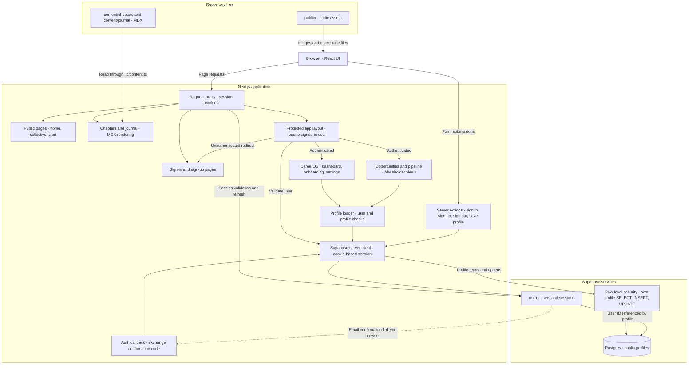

# Kubacki Collective architecture

This diagram describes the current repository: a Next.js App Router application combining the public Kubacki Collective site and a protected CareerOS workspace. It documents the code and SQL definitions; it does not confirm the configuration of a deployed environment.

## Main flows

- **Public content:** chapter and journal routes load repository MDX through `lib/content.ts`, then render it with `next-mdx-remote/rsc`. Slugs are supplied by `generateStaticParams`.
- **Authentication:** forms invoke `app/actions/auth.ts`. Supabase handles password authentication and sign-up. When email confirmation is required, `/auth/callback` exchanges the confirmation code for a session. `proxy.ts` runs session handling for matching requests; the protected app layout performs the signed-in user check.
- **Onboarding:** sign-in and callback flows check whether the profile has a full name and target role, redirecting incomplete profiles to `/onboarding`. Dashboard, opportunities, and pipeline also check profile completeness.
- **Profiles:** `app/actions/profile.ts` validates submitted salary values and upserts the current user's profile. Server-rendered pages load profiles through `lib/profile.ts`. The SQL defines ownership policies using `auth.uid() = user_id` and an update timestamp trigger.

## Implementation boundaries

- Opportunities and pipeline currently render empty states; there is no opportunity storage or job-ingestion integration in the current code.
- `lib/supabase/client.ts` defines a browser client helper, but current application callers use the server client. A direct browser-to-database path is therefore omitted from the diagram.
- `supabase/profiles.sql` defines the profile schema and policies. Applying that SQL and configuring Supabase are deployment prerequisites, not verified by this document.
- Hosting and automatic deployment are not shown because the repository does not establish a deployment topology.

## Source map

| Responsibility | Source |
| --- | --- |
| Request session handling | [`proxy.ts`](proxy.ts), [`lib/supabase/middleware.ts`](lib/supabase/middleware.ts) |
| Protected workspace | [`app/(app)/layout.tsx`](app/%28app%29/layout.tsx) |
| Authentication | [`app/actions/auth.ts`](app/actions/auth.ts), [`app/auth/callback/route.ts`](app/auth/callback/route.ts) |
| Profile reads and writes | [`lib/profile.ts`](lib/profile.ts), [`app/actions/profile.ts`](app/actions/profile.ts) |
| Server-side Supabase access | [`lib/supabase/server.ts`](lib/supabase/server.ts) |
| Profile schema and policies | [`supabase/profiles.sql`](supabase/profiles.sql) |
| Content loading | [`lib/content.ts`](lib/content.ts), [`content/`](content/) |
