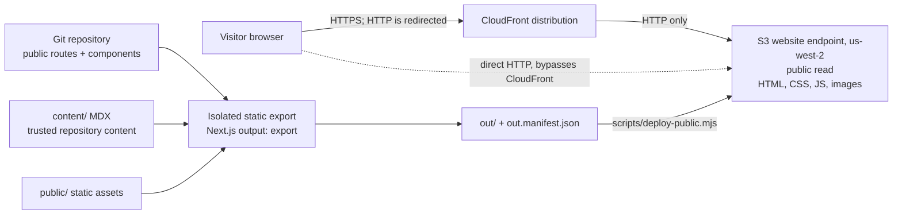

# Kubacki Collective public site

This repository contains two distinct codebases. The public Kubacki Collective website is the production site at [kubackicollective.com](https://kubackicollective.com), branded “By TeamDryBox LLC.” It is built as static files and hosted in an AWS S3 bucket behind CloudFront. The repository also retains a separate CareerOS scaffold; its auth and workspace routes are not part of the public site or production export. See [the CareerOS scaffold notes](docs/legacy/careeros-scaffold-architecture.md) for its historic implementation details.

## Production architecture

## Production configuration

Observed with read-only AWS calls on November 25, 2026:

| Setting | Value |
| --- | --- |
| Aliases | `kubackicollective.com`, `www.kubackicollective.com` |
| Origin | `kubackicollective.com.s3-website-us-west-2.amazonaws.com`, `http-only`, no origin access control |
| Viewer protocol | Redirect to HTTPS |
| Cache policy | AWS managed `CachingOptimized` |
| S3 index / error document | `index.html` / `index.html` |
| Bucket versioning | Not enabled |

Because the error document is `index.html`, an unknown URL returns status 404 with the homepage document. The styled `404.html` in the export is not used by S3. Versioning is off, so an overwritten or deleted object can only be restored from a copy taken beforehand.

The public export uses Next.js App Router for compile-time rendering. At request time, S3 and CloudFront return files; there is no Next.js server, Node runtime, Supabase connection, authentication flow, server action, or API route in the production public site. The isolated build copies an explicit allowlist so the CareerOS scaffold cannot leak into the artifact by accident.

Public routes are `/`, `/collective`, `/start`, `/chapters`, `/chapters/[slug]`, `/journal`, and `/journal/[slug]`. Dynamic content routes are rendered during the build from committed MDX. `trailingSlash: true` produces directory-style route files; the build also writes `.html` compatibility aliases for clients that previously used those paths.

## Content and image flow

- `content/chapters/` and `content/journal/` hold trusted, reviewed MDX. Frontmatter and rendering are handled by `lib/content.ts` and the MDX components. New content becomes public only after it is committed and included in a new export.
- `public/` holds static assets addressed by root-relative URLs. Keep image alternatives meaningful and verify image dimensions/crop on mobile and desktop.
- `lib/public-images.ts` is the central portrait list for the home and Collective carousels. Keep each `src` aligned with a file under `public/`; keep descriptive `alt` text and a short label.
- `components/collective/PortraitCarousel.tsx` owns carousel presentation and rotation. Honor reduced-motion preferences and ensure controls remain keyboard accessible when changing its behavior.
- Never add private credentials or `.env` files to the public build. The allowlist deliberately excludes auth, server actions, proxy, Supabase and environment files.

MDX is executable content in the build context. Treat it as trusted source: review changes, avoid unreviewed third-party MDX, and do not accept arbitrary visitor-supplied MDX.

## Design and accessibility standards

Keep the existing editorial tone and shared site shell. Prefer the design tokens and shared components in `app/globals.css` and `components/` over route-specific one-off styles. Public pages should retain clear headings, visible focus, semantic links and buttons, useful image alternatives, responsive layout, and reduced-motion support. Check narrow mobile widths as well as desktop after layout or carousel changes.

## Source map

| Responsibility | Files |
| --- | --- |
| Site shell, metadata, global styles | `app/layout.tsx`, `components/public-site-shell.tsx`, `app/globals.css` |
| Home and public pages | `app/page.tsx`, `app/collective/`, `app/start/` |
| Chapter and journal routes | `app/chapters/`, `app/journal/`, `lib/content.ts`, `content/` |
| Navigation and shared visual components | `components/Header.tsx`, `components/Footer.tsx`, `components/` |
| Public build, preview and upload | `scripts/build-public.mjs`, `scripts/serve-public.mjs`, `scripts/deploy-public.mjs` |
| Test guidance | [`docs/testing.md`](docs/testing.md) |
| Release procedure | [`docs/operations/release.md`](docs/operations/release.md) |
| Security posture and evidence | [`docs/security/2026-11-25-review.md`](docs/security/2026-11-25-review.md), [`docs/security/2026-11-25-carousel-check.md`](docs/security/2026-11-25-carousel-check.md) |

## Security and operational limits

The static export narrows runtime exposure, but does not by itself secure the AWS account, S3 origin, DNS, build chain, dependency tree, or browser delivery. The dated security review records open dependency and infrastructure findings; consult it before describing any item as resolved. The S3 website origin has historically been publicly addressable over HTTP and can bypass CloudFront controls. Verify the current origin configuration and access policy during deployment. Do not put secrets in this repository or the output bucket. The public client bundle must contain only content intended for public visitors.

For build, release, validation, and rollback steps, use the [release runbook](docs/operations/release.md). The static build manifest records the source commit, whether the checkout is dirty, build configuration, allowlisted sources, and hashes for every output file. A release must use a clean, committed source tree.
